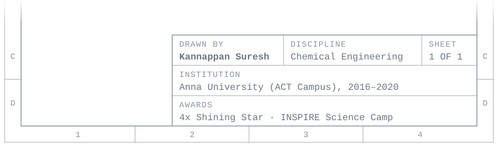

<picture>
  <source media="(min-width: 601px) and (prefers-color-scheme: dark)" srcset="https://raw.githubusercontent.com/kannasuresh99/kannasuresh99/main/assets/hero-schematic-dark.svg">
  <source media="(min-width: 601px) and (prefers-color-scheme: light)" srcset="https://raw.githubusercontent.com/kannasuresh99/kannasuresh99/main/assets/hero-schematic-light.svg">
  <source media="(prefers-color-scheme: dark)" srcset="https://raw.githubusercontent.com/kannasuresh99/kannasuresh99/main/assets/hero-schematic-narrow-dark.svg">
  <source media="(prefers-color-scheme: light)" srcset="https://raw.githubusercontent.com/kannasuresh99/kannasuresh99/main/assets/hero-schematic-narrow-light.svg">
  
</picture>

## Models are probabilistic. The systems I build around them aren't.

**Kannappan Suresh** · Backend & AI Engineer · Chennai, India

I build production LLM and agentic systems, and the secure multi-tenant backends under them, for regulated domains: legal, life sciences, fintech. Currently Senior Software Engineer, AI/ML at **ValGenesis**. Shipping production software since 2021.

[LinkedIn](https://www.linkedin.com/in/kannappan-suresh-kannan99) · [GitHub](https://github.com/kannasuresh99)

In pharma, "mostly right" is not a spec. So I don't take the model's word for it: the LLM extracts, deterministic checks validate, a human stays at the gate, and every output leaves a trail an auditor can follow.

**Measure it. Control it. Prove it.**

### What I'm running now

**Senior Software Engineer, AI/ML · ValGenesis** · Apr&nbsp;2026&nbsp;–&#8288;&nbsp;present<br>
Agentic document-intelligence services for a GxP-regulated validation platform (pharma / life sciences).

`MEASURE` Raised extraction accuracy on a large-document gap-assessment pipeline from ~70% to ~90%, scored against a gold-set regression harness. Measured, not felt.

`RETRIEVE` Got there by re-architecting retrieval over a trace graph (hybrid and graph-based search), plus targeted model optimizations. Built an organization-wide Neo4j knowledge graph that powers graph-RAG across AI services.

`GATE` Paired LLM extraction with deterministic validation and human-in-the-loop gates on multi-tenant, permission-aware processing, so every AI output stays traceable and audit-ready (21 CFR Part 11).

`FLOW` Designed a shared queuing service on Azure Service Bus for AI workloads (shuffle-sharding, idempotent consumers, outbox pattern) that brought tenant fairness, with per-tenant throughput and latency metrics.

`COST` Cut LLM inference cost and latency with context caching, batch processing and thinking-budget tuning, tracked by token-level cost and latency observability.

`JUDGMENT` Wrote engineering guidelines for using AI coding tools responsibly (review discipline, test coverage, and keeping design judgment with the engineer) and ran the internal rollout to other teams.

```
in:  large documents
     gap-assessment pipeline
out: ~70% → ~90% accuracy
     (gold-set harness)
     audit-ready
```

### How I got here

**Senior Software Engineer, Founding Team · Enegma (Tangerine Ventures)** · Jul&nbsp;2025&nbsp;–&#8288;&nbsp;Feb&nbsp;2026<br>
`STANDARDIZE THE REACTOR` A new agent used to take weeks. On the LangGraph framework I built, it took about a day.

```
in:  weeks to build
     each new agent
out: ~1 day per agent
```

<details>
<summary>More from Enegma</summary>

- Built a reusable agentic framework on LangGraph that standardizes lifecycle, memory persistence, tool integration and multi-agent orchestration.
- ~5x faster time-to-first-token and ~90% prompt-token reduction for real-time agents, via micro-prompting (200 to 800-token decomposed prompts).
- Wrote a DSL that expresses agent behavior as SOP-to-AOP execution flows behind an agent-canvas abstraction, so behavior changes without touching core code. Workflow iteration time cut ~60%.
- Stood up CI/CD and engineering practice as founding engineer.

</details>

**Software Engineer 2 · PayPal** · Dec&nbsp;2024&nbsp;–&#8288;&nbsp;Jul&nbsp;2025<br>
`MAP BEFORE YOU MOVE` Breaking up Venmo's monolith meant a nine-month manual decomposition process. I built agents that read the code instead.

```
in:  Venmo monolith
     9-month manual process
out: agentic workflow
     migration ~30% faster
```

<details>
<summary>More from PayPal</summary>

- Conceived and built CodexMap, an agentic RAG code-intelligence platform (AST parsing, semantic embeddings, LLM reasoning agents) that generates service maps and call graphs. It cut architectural analysis ~60% and dependency discovery ~70%.
- Turned a 9-month manual service-decomposition process into an automated agentic workflow, accelerating Venmo's monolith-to-microservices migration ~30%.
- Shipped a refactoring tool adopted across multiple PayPal teams.

</details>

**Software Engineer · Kissflow** · Jan&nbsp;2024&nbsp;–&#8288;&nbsp;Dec&nbsp;2024<br>
`LOSE NOTHING` Over sixty million records. Zero lost. Fifteen percent early. This is where LLMs enter the story: prompt templates powering AI-assisted automation in Kissflow's no-code engine.

```
in:  60M+ records on GCS
out: on MongoDB
     zero data loss
     retrieval time -40%
```

<details>
<summary>More from Kissflow</summary>

- Migrated 60M+ records from GCS to MongoDB 15% ahead of schedule with zero data loss, cutting retrieval time 40% with optimized indexing and batch processing.
- Shipped a platform feature in 4 weeks, now used daily by 10,000+ business clients (engagement +25%, task time -30%).

</details>

**Software Engineer · Saama Technologies** · Jul&nbsp;2021&nbsp;–&#8288;&nbsp;Dec&nbsp;2023<br>
`FOUNDATIONS` Backend work on two large-scale clinical SaaS products. 4x Shining Star Award (monthly best performer).

```
in:  REST APIs
     ingestion pipelines
out: API efficiency +20%
     app performance +12%
     ingestion +10%
```

<details>
<summary>More from Saama</summary>

- Improved backend REST API efficiency 20% through query optimization and data modeling (Python, Flask, PostgreSQL, Redis, Celery, Kubernetes).
- Boosted app performance 12% and ingestion throughput 10% with Kubernetes pod auto-scaling and Kafka data pipelines on AWS.

</details>

### Bill of Materials

| Function | Parts |
|---|---|
| `REACTOR` | LangGraph · LangChain · Pipecat · multi-agent orchestration · prompt engineering · micro-prompting |
| `RETRIEVAL` | RAG and graph-RAG · hybrid search · re-ranking · OCR / long-document chunking · batch inference · embeddings · LanceDB |
| `INSTRUMENTATION` | eval-driven development (gold-set harnesses, LLM-as-judge) · cost/latency observability · metrics · structured logging · tracing |
| `FLOW` | FastAPI · Flask · Django · gRPC/REST API design · event-driven microservices · Celery · Azure Service Bus · Kafka · outbox · idempotency |
| `STORAGE` | PostgreSQL · MongoDB · Redis · Neo4j |
| `CONTROLS` | multi-tenant isolation · permission-aware access · tenant fairness (shuffle-sharding) · provenance / audit trails · 21 CFR Part 11 / GxP |
| `INFRASTRUCTURE` | GCP (Vertex AI, Gemini) · Azure (Service Bus, AKS, OpenAI) · AWS (EC2, S3, Lambda, SQS, ECS) · Docker · Kubernetes · Terraform |
| `LANGUAGES` | Python (expert) · SQL · TypeScript · Bash |

**Education** · B.Tech, Chemical Engineering, Anna University (ACT Campus), Chennai · 2016–2020 · CGPA 8.19/10<br>
**Awards** · 4x Shining Star Award (monthly best performer), Saama Technologies · INSPIRE Science Camp, Govt. of India (top 200 nationally)

<picture>
  <source media="(min-width: 601px) and (prefers-color-scheme: dark)" srcset="https://raw.githubusercontent.com/kannasuresh99/kannasuresh99/main/assets/title-block-dark.svg">
  <source media="(min-width: 601px) and (prefers-color-scheme: light)" srcset="https://raw.githubusercontent.com/kannasuresh99/kannasuresh99/main/assets/title-block-light.svg">
  <source media="(prefers-color-scheme: dark)" srcset="https://raw.githubusercontent.com/kannasuresh99/kannasuresh99/main/assets/title-block-narrow-dark.svg">
  <source media="(prefers-color-scheme: light)" srcset="https://raw.githubusercontent.com/kannasuresh99/kannasuresh99/main/assets/title-block-narrow-light.svg">
  
</picture>

<p align="right">Same discipline. New reactor.</p>
