<picture>
  <source media="(max-width: 1011px)" srcset="https://raw.githubusercontent.com/kannasuresh99/kannasuresh99/main/assets/hero-narrow.svg">
  
</picture>

## Models are probabilistic. The systems I build around them aren't.

I build production LLM and agentic systems, and the secure multi-tenant backends under them, for regulated domains: legal, life sciences, fintech. Currently Senior Software Engineer, AI/ML at **ValGenesis**. Shipping production software since 2021.

The LLM extracts. Deterministic checks validate. A human approves. Every output leaves a trail an auditor can follow.

**Measure it. Control it. Prove it.**

[LinkedIn](https://www.linkedin.com/in/kannappan-suresh-kannan99) · [GitHub](https://github.com/kannasuresh99)

### Built from the base up

I design the whole system, not only the prompt: from the cluster at the bottom to the controls at the top that make AI output trustworthy. Each color is one layer, and it keeps that meaning in every diagram on this page.

<picture>
  <source media="(max-width: 1011px)" srcset="https://raw.githubusercontent.com/kannasuresh99/kannasuresh99/main/assets/stack-narrow.svg">
  
</picture>

### How I build large-document pipelines

The LLM is one stage. Everything around it exists to give it the right context, check its work, and show where each answer came from.

<picture>
  <source media="(max-width: 1011px)" srcset="https://raw.githubusercontent.com/kannasuresh99/kannasuresh99/main/assets/pipeline-narrow.svg">
  
</picture>

### Agentic systems I've built

How they work, and what they changed.

<picture>
  <source media="(max-width: 1011px)" srcset="https://raw.githubusercontent.com/kannasuresh99/kannasuresh99/main/assets/agents-narrow.svg">
  
</picture>

### How I work a problem

Measure first. Find the constraint. Change the system. Prove the result.

<picture>
  <source media="(max-width: 1011px)" srcset="https://raw.githubusercontent.com/kannasuresh99/kannasuresh99/main/assets/cases-narrow.svg">
  
</picture>

### Where I've shipped

Each role added a layer: backend and data first, then retrieval and agents, and now the controls that let AI run in regulated work.

<picture>
  <source media="(max-width: 1011px)" srcset="https://raw.githubusercontent.com/kannasuresh99/kannasuresh99/main/assets/journey-narrow.svg">
  
</picture>

<b>ValGenesis</b> · Senior Software Engineer, AI/ML · Apr 2026 – present

Agentic document-intelligence services for a GxP-regulated validation platform (pharma / life sciences).

- Pair LLM extraction with deterministic validation and human-in-the-loop gates on multi-tenant, permission-aware processing, so every AI output stays traceable and audit-ready (21 CFR Part 11).
- Raised extraction accuracy of a large-document pipeline from ~70% to ~90%, measured against a gold-set regression harness, by re-architecting retrieval over a trace graph with hybrid and graph-based search plus targeted model optimizations.
- Designed and built an organization-wide knowledge-graph system on Neo4j that unifies entity and dependency context to power graph-RAG retrieval across AI services.
- Designed a shared queuing service on Azure Service Bus for AI workloads (shuffle-sharding, idempotent consumers, outbox pattern) that brought tenant fairness to multi-tenant systems, instrumented with per-tenant throughput and latency metrics.
- Cut LLM inference cost and latency with context caching, batch processing and thinking-budget tuning, tracked by token-level cost and latency observability.
- Wrote engineering guidelines for using AI coding tools responsibly (review discipline, test coverage, and keeping design judgment with the engineer) and ran the internal rollout to other teams.

<b>Enegma</b> (Tangerine Ventures) · Senior Software Engineer, Founding Team · Jul 2025 – Feb 2026

- Built a reusable agentic framework on LangGraph that standardizes lifecycle, memory persistence, tool integration and multi-agent orchestration, cutting new-agent development from weeks to ~1 day.
- ~5× faster time-to-first-token and ~90% prompt-token reduction for real-time agents, via micro-prompting (200 to 800-token decomposed prompts).
- Cut workflow iteration time ~60% with a DSL that expresses agent behavior as SOP-to-AOP execution flows behind an agent-canvas abstraction, so behavior changes without touching core code.
- Stood up CI/CD and engineering practice as founding engineer.

<b>PayPal</b> · Software Engineer 2 · Dec 2024 – Jul 2025

- Conceived and built CodexMap, an agentic RAG code-intelligence platform (AST parsing, semantic embeddings, LLM reasoning agents) that generates service maps and call graphs, cutting architectural analysis ~60% and dependency discovery ~70%.
- Accelerated Venmo's monolith-to-microservices migration ~30% by turning a 9-month manual service-decomposition process into an automated agentic workflow.
- Shipped a refactoring tool adopted across multiple PayPal teams.

<b>Kissflow</b> · Software Engineer · Jan 2024 – Dec 2024

- Migrated 60M+ records from GCS to MongoDB 15% ahead of schedule with zero data loss, cutting retrieval time 40% through optimized indexing and batch processing.
- Shipped a platform feature in 4 weeks, now used daily by 10,000+ business clients (engagement +25%, task time −30%).
- Built LLM prompt templates powering AI-assisted automation in the no-code engine. This is where LLMs enter the story.

<b>Saama Technologies</b> · Software Engineer · Jul 2021 – Dec 2023

- Improved backend REST API efficiency 20% for two large-scale clinical SaaS products through query optimization and data modeling (Python, Flask, PostgreSQL, Redis, Celery, Kubernetes).
- Boosted app performance 12% and ingestion throughput 10% with Kubernetes pod auto-scaling and Kafka data pipelines on AWS.
- 4× Shining Star Award (monthly best performer).

### Toolkit

| Layer | Tools and patterns |
|---|---|
| `TRUST & CONTROLS` | deterministic validation · human-in-the-loop gates · provenance / audit trails · multi-tenant isolation · permission-aware access · 21 CFR Part 11 / GxP |
| `AGENTS` | LangGraph · LangChain · Pipecat · multi-agent orchestration · prompt engineering · micro-prompting · context caching · thinking-budget tuning |
| `RETRIEVAL` | RAG and graph-RAG · hybrid search · re-ranking · embeddings · OCR / long-document chunking · batch inference · content-hash caching |
| `EVALS & OBSERVABILITY` | eval-driven development (gold-set harnesses, LLM-as-judge) · token-level cost / latency observability · metrics · structured logging · tracing |
| `SERVICES & APIs` | FastAPI · Flask · Django · gRPC / REST API design · event-driven microservices |
| `MESSAGING & QUEUES` | Azure Service Bus · Kafka · Celery · outbox · idempotent consumers · tenant fairness (shuffle-sharding) |
| `DATA STORES` | PostgreSQL · MongoDB · Redis · Neo4j · LanceDB |
| `INFRASTRUCTURE` | GCP (Vertex AI, Gemini) · Azure (Service Bus, AKS, OpenAI) · AWS (EC2, S3, Lambda, SQS, ECS) · Docker · Kubernetes · Terraform |
| `LANGUAGES` | Python (expert) · SQL · TypeScript · Bash |

**Education** · B.Tech, Chemical Engineering, Anna University (ACT Campus), Chennai · 2016–2020 · CGPA 8.19/10 
**Awards** · 4× Shining Star Award (monthly best performer), Saama Technologies · INSPIRE Science Camp, Govt. of India (top 200 nationally)

[LinkedIn](https://www.linkedin.com/in/kannappan-suresh-kannan99) · [GitHub](https://github.com/kannasuresh99)

<picture>
  <source media="(max-width: 1011px)" srcset="https://raw.githubusercontent.com/kannasuresh99/kannasuresh99/main/assets/footer-narrow.svg">
  
</picture>

<i>Same discipline. New reactor.</i>

